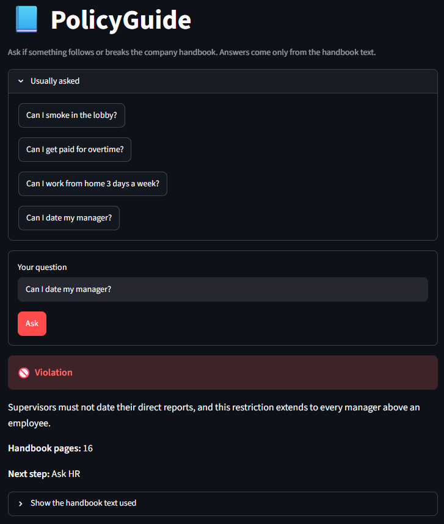

# PolicyGuide

A RAG assistant that helps new employees check if an action follows or breaks company policy. It answers from the handbook text only, and shows the page it used.



## What it does

You type a question, such as "Can I smoke in the lobby?" The assistant replies with:

- **Verdict:** Allowed, Violation, Depends, or Unclear
- **Reason:** a short explanation, taken from the handbook
- **Pages:** the handbook pages it relied on
- **Next step:** what to do, or who to ask
- **Evidence:** the handbook text behind the answer, so you can check it yourself

If the handbook does not cover a question, the assistant says so and tells the user to ask HR. It does not guess.

## The app

The interface is a Streamlit web app (`src/app.py`):

- A question box with a few example questions to click
- A colour-coded verdict (green for Allowed, red for Violation, yellow for Depends, blue for Unclear)
- An expandable section with the exact handbook text used for the answer
- A friendly message if the model cannot be reached, instead of a crash
- A limit of 20 questions per session, to protect the free API quota

On the first start, the app builds the search index by itself if it is missing.

## How it works

1. **Ingest:** `src/ingest.py` reads the handbook PDF and splits each page into chunks of up to 1000 characters. Each chunk keeps its page number.
2. **Index:** `src/store.py` turns the chunks into vectors with a free embedding model (Chroma's default, all-MiniLM-L6-v2) and saves them in a local `db/` folder.
3. **Search:** `src/search.py` finds the 3 chunks closest in meaning to the question.
4. **Answer:** `src/answer.py` sends those chunks and the question to Google Gemini with a strict prompt. The model must reply in JSON. The code then checks the reply.
5. **App:** `src/app.py` shows the answer in the browser.
6. **Evaluate:** `src/eval.py` runs a fixed test set and reports the score.

## Guardrails

These are layered. None of them is a complete defence on its own.

- **Input checks:** empty, very long, or obviously manipulative questions are refused before any API call.
- **Prompt design:** the question and the handbook excerpts are labelled as data. The model is told not to follow instructions inside them, and to answer only from the excerpts.
- **Citation check:** a decisive verdict (Allowed, Violation, Depends) is only accepted if it cites a page that search actually returned. Otherwise the answer becomes Unclear.
- **Reply check:** a reply that is not valid JSON is retried, then replaced with a safe "ask HR" answer. An unquoted key from the model is repaired before parsing.
- **Network errors:** dropped connections are retried. If the model cannot be reached at all, the code raises an error instead of returning a fake answer, and the app shows a clear message.

## Results

Test set: 19 questions in `data/test_questions.json`. Most were written by me (an AI assistant), and some by the project owner. Each has an expected verdict and, where the handbook covers it, an expected page.

| Run | Verdict accuracy | Correct page cited |
|---|---|---|
| Final run | 19/19 | 16/16 |

Ran 3 times with the same settings. One earlier run scored 18/19 because a network error stopped one question. That is reported as a failure, and the retry was added after it.

**Two test labels were corrected** after checking the handbook text. In both cases the bot's answer matched the document and the first label did not.

The test set checks the answers from `answer_question()`. It does not test the web interface.

### Known limits

- The test set is small (19 questions), and most were written by the same people who built the bot. The score shows the bot works on these cases. It does not prove general accuracy.
- The bot once dropped a condition in "more than one remote day needs manager approval". A prompt rule now handles it. It is the kind of rule that could break other answers, so it should be checked again after any change.
- The handbook is a sample template from a public source, with placeholder text. It is not a real company's policy, and it is a UK-style document in places.
- The question limit in the app is easy to get around by refreshing the page. It only protects against accidents.
- The assistant is a guide, not a legal or HR decision. HR has the final say.

## Setup

Requirements: Python 3.10 or newer, and a free Gemini API key from Google AI Studio.

```bash
git clone <your-repo-url>
cd policy-guide
python -m venv venv
venv\Scripts\activate          # Windows
pip install -r requirements.txt
```

Create a file named `.env` in the project root:

``` 
GEMINI_API_KEY=your-key-here
```

Never commit `.env` or the `db/` folder. The `.gitignore` already lists them.

## Run the app

From the project root (`policy-guide`):

```bash

streamlit run src/app.py
```

A browser tab opens at `http://localhost:8501`.

## Other scripts

From the `src` folder:

```bash
python store.py              # build the index (the app also does this when it is missing)
python eval.py               # run the test set and print the score
python retrieval_check.py    # check search only, no API calls
```

To ask a single question without the app:

```bash
python -c "from answer import answer_question; print(answer_question('Can I smoke in the lobby?'))"
```

## Project layout

```
policy-guide/
├── data/
│   ├── handbook.pdf
│   └── test_questions.json
├── src/
│   ├── app.py
│   ├── ingest.py
│   ├── store.py
│   ├── search.py
│   ├── answer.py
│   ├── eval.py
│   ├── retrieval_check.py
│   └── experiment.py
├── requirements.txt
└── .gitignore
```

## Credits and sources

- Handbook: sample employee handbook template (Workable), used for learning and testing only.
- Built with pypdf, Chroma, google-genai, python-dotenv, and Streamlit.

## Before you publish

- Replace `<your-repo-url>` with your real repository link.
- Check that the handbook's license allows use in a public repo. If you are not sure, leave `handbook.pdf` out of the repo and tell users to add their own copy.
- Check that your real API key does not appear anywhere in the repo, and that `.env` is not uploaded.